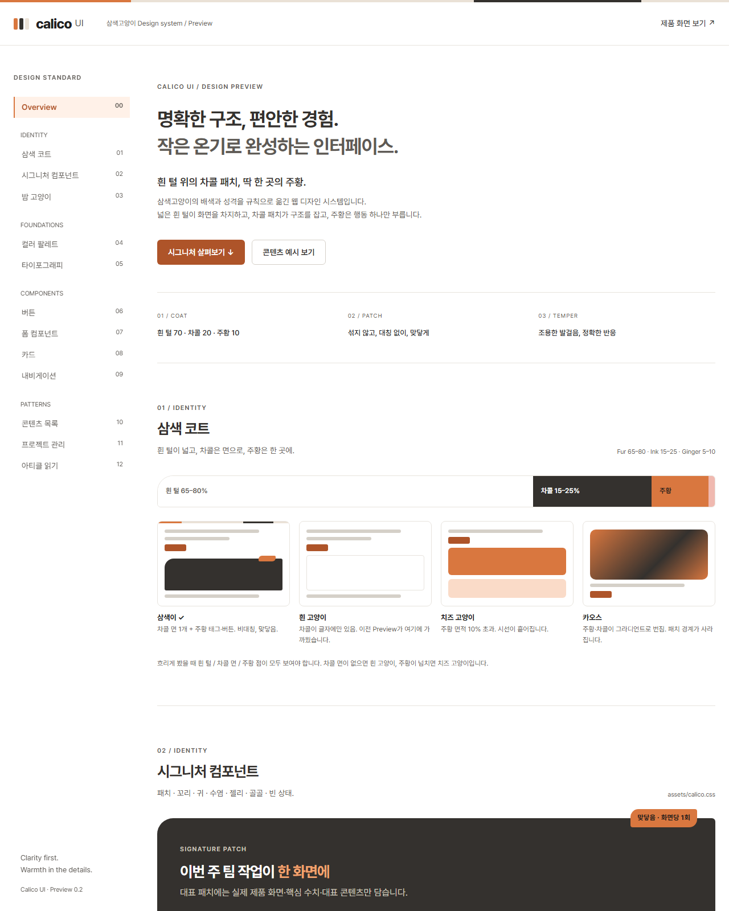

# Web_Design_Calico · 삼색고양이 디자인 시스템

삼색고양이(calico)의 **털 배색**(넓은 흰 털 + 또렷한 차콜·주황 패치)과 **성격**(조용한 발걸음, 정확한 반응)을 규칙으로 옮긴 웹 디자인 스킬입니다. v1.0은 일반적인 "깔끔한 SaaS" 가이드에 가까워 삼색이다운 정체성이 없었습니다. v2는 코트 비율, 패치 규칙, 시그니처 컴포넌트, 장난기 레벨, 밤 고양이(다크 모드)를 추가했습니다.



## 구성

| 파일 | 내용 |
|---|---|
| [SKILL.md](SKILL.md) | 먼저 정할 것, 코트 규칙(비율·섞지 않기·비대칭·상한), 형태, 시그니처 컴포넌트, 성격(움직임·피드백·말투), 장난기 레벨, 화면 유형, 다크 모드, 금지 목록, 점검표 |
| [references/tokens.md](references/tokens.md) | 라이트/다크 색 토큰과 WCAG 대비, 형태·간격·글자·움직임 토큰 |
| [references/patterns.md](references/patterns.md) | 코트 스트립, 대표 패치 + 패치 태그, 주황 지표, 꼬리 탭, 귀 쫑긋 카드, 골골 토스트, 조용한 빈 상태, 하악 오류 마크업과 화면 레시피 5종 |
| [assets/calico.css](assets/calico.css) | 토큰(`--c-*`)과 시그니처 컴포넌트(`.c-*`). 다른 프로젝트에 그대로 가져다 쓸 수 있음 |
| index.html · styles.css · app.js | 동작하는 Preview |

## 핵심 규칙 세 줄

1. **흰 털 65–80 / 차콜 15–25 / 주황 5–10.** 차콜은 글자뿐 아니라 면(패치)으로 최소 1번 나와야 합니다.
2. **패치는 섞지 않고, 대칭 없이, 맞닿게.** 그라디언트를 쓰지 않고, 차콜 패치 모서리에 주황 태그를 한 번만 걸칩니다.
3. **고양이는 숨어 있을 때 더 고양이 같다.** 고양이 그림은 쓰지 않고 배색·패치·동작으로만 표현하며, 기능 UI 문구에는 `냥`이나 이모지를 쓰지 않습니다.

## 사용 예

- "Calico 스킬로 팀 프로젝트 관리 SaaS 랜딩 페이지 만들어 줘" → 레벨 1, 히어로 아래 제품 화면을 담은 차콜 패치
- "Calico 레벨 0으로 재고 관리 어드민 화면 만들어 줘" → 차콜 요약 띠 + 꼬리 탭 + 수염선 표
- "Calico 레벨 2로 서비스 온보딩/404 만들어 줘" → 큰 대표 패치, 빈 상태/404 말장난 1회

## Preview 실행

```powershell
node server.cjs
```

http://127.0.0.1:4173 에 접속합니다. 서버 없이 index.html을 브라우저로 열어도 동작합니다.

새 섹션은 **삼색 코트**(비율 막대, 삼색이·흰 고양이·치즈 고양이·카오스 비교), **시그니처 컴포넌트**(대표 패치 + 맞닿음 태그, 꼬리 탭, 귀 쫑긋 카드, 골골 토스트 + 되돌리기, 하악 오류, 조용한 빈 상태, 장난기 레벨 표), **밤 고양이**(`data-theme="dark"` 영역)입니다. 기존 팔레트·타이포·버튼·폼·카드·내비·목록·대시보드·아티클 섹션은 그대로 남아 있습니다.

브랜드 원색 #D9773F는 보존했습니다. 흰 바탕 글자와 흰 글자 버튼에는 대비를 위해 #AE5429를 씁니다.

## 확인

```powershell
npm.cmd run check
```

JavaScript 문법 검사입니다. 헤드리스 Chrome으로 1440px와 최소 폭(약 485px)에서 렌더링과 가로 넘침을 확인했습니다. 390px 실기기, 전체 접근성 인증, 모든 브라우저 호환성은 검증하지 않았습니다.
