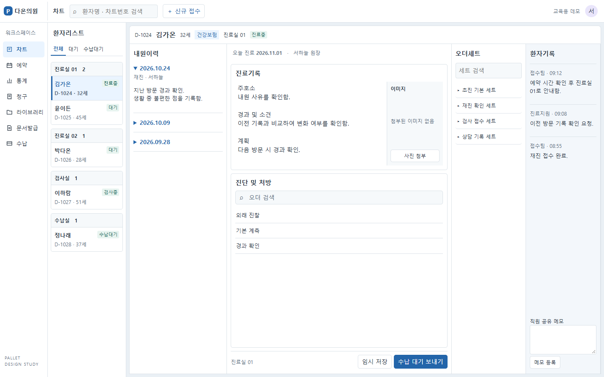

# Web_Design_Pallet · 외래 진료 차트

[index.html](index.html)을 로컬 브라우저로 열면 가상의 다온의원에서 환자 한 명의 차트를 확인할 수 있습니다. 별도 서버나 라이브러리 설치가 필요 없습니다. **게시된 원본 제품과 독립적인 인터랙션 예제**이며, 실제 환자 등록·문서 발급·보험 청구는 하지 않습니다.

## 비교 기준

[공식 매뉴얼](https://dr.pltt.cloud/manual)의 고유 영상 11편에서 각 6개 시점의 화면 표본을 재검토하고, [진료 0:16](https://www.youtube.com/watch?v=7B7kH7m03RA&t=16s)의 실제 1280px 프레임을 열어 열 순서와 경계를 대조했습니다. 영상 속 안내 자막, 확대 화살표, 환자 정보는 옮기지 않았습니다.

| 비교한 장면 | 실제 화면에서 읽은 구조 | 이 예제의 대응 |
|---|---|---|
| [접수 1:07](https://www.youtube.com/watch?v=PrtRnLLTnOM&t=67s) · [차트 2:44](https://www.youtube.com/watch?v=WKeU2Z4ebLU&t=164s) | 검색·접수창에서 대상을 정한 뒤 차트로 진입. 좌측 환자 목록과 과거 내원이력이 다른 열에 남음 | 상단 검색과 신규 접수, 진료실별 목록, 선택 환자의 차트번호와 날짜별 내원이력 |
| [진료 0:16](https://www.youtube.com/watch?v=7B7kH7m03RA&t=16s) · [진단 및 처방 0:40](https://www.youtube.com/watch?v=bX437bPd6pk&t=40s) | 진료기록 내부에 이미지 영역, 바로 아래 진단·처방, 옆에 오더세트와 환자기록. 검색은 차트 위에 열림 | 기록 편집·로컬 첨부·확대, 오더 검색, 세트 삽입, 직원 메모와 수납 대기 이동 |
| [문서 발급 0:32](https://www.youtube.com/watch?v=Jn_sfEzZ7hg&t=32s) · [청구 1:34](https://www.youtube.com/watch?v=335HY52YPGA&t=94s) | 짧은 추가 입력은 창으로, 여러 건의 검토는 내역 목록으로 구분 | 환자별 문서 발급 이력, 수납 완료 건의 청구 검토 표 |
| [예약·CRM 2:20](https://www.youtube.com/watch?v=jHWTogR7JSc&t=140s) · [라이브러리 0:26](https://www.youtube.com/watch?v=0z9cgDYJXLE&t=26s) | 시간 축의 일정표와 서식 미리보기는 서로 다른 작업면 | 일간 예약표·슬롯 중복 방지, 서식 선택·현재 차트에 삽입. CRM 메시지 발송은 구현 범위 밖 |
| [통계 1:28](https://www.youtube.com/watch?v=krSw2ooCF1c&t=88s) · [인사이트 0:18](https://www.youtube.com/watch?v=WNIjUaqvL-I&t=18s) · [소개 0:56](https://www.youtube.com/watch?v=Jfi246Juez8&t=56s) | 수치 조회 표, 비교용 그래프, 데스크톱 작업면의 역할이 다름 | 동일한 가상 접수 건수를 표·분포 그래프로 전환. 원본 경영지표가 아닌 예시 지표 |

## 직접 확인하기

1. **차트**에서 과거 내원일을 펼치고 오늘 기록을 수정합니다. 다른 환자를 선택해도 작성 중인 기록은 환자별로 남습니다.
2. **오더 검색**으로 항목을 추가하거나 **오더세트**에서 묶음의 내용을 확인한 뒤 적용합니다. **직원 공유 메모**는 진료기록과 별도로 저장됩니다.
3. **수납 대기 보내기 → 수납 → 수납 완료 → 청구** 순으로 같은 차트번호가 이동하는지 확인합니다.
4. **라이브러리**에서 서식을 차트에 삽입하거나, **예약**에서 일정을 추가합니다. **문서발급**은 선택한 환자의 가상 발급 이력만 갱신합니다.

데모 상태와 첨부는 페이지 메모리에서만 유지되며 새로고침하면 초기화됩니다. 가상 데이터로 사용하세요. 넓은 화면에서 원본의 동시 비교 구조를 볼 수 있고, 좁은 화면에서는 보조 구역을 아래로 이동합니다.

[SKILL.md](SKILL.md)는 다른 프로젝트에 적용할 설계 지침, [preview.css](preview.css)는 패널·밀도·반응형 규칙, [preview.js](preview.js)는 가상 데이터와 화면 동작입니다.
